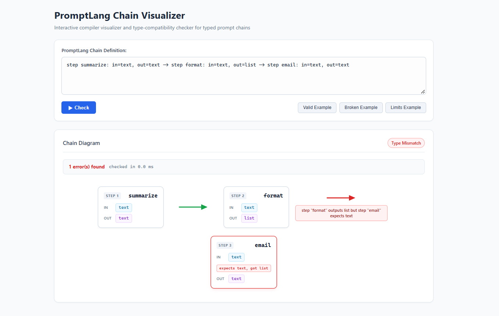

# PromptLang

A type-safe compiler for structured LLM prompt chains: catches broken prompt pipelines before any API call.

## The problem

LLM pipelines are often built by chaining prompts, where each step's output becomes the next step's input.
If one step returns JSON and the next step expects plain text, nothing complains when you write the chain.
You find out only at run time, after the first steps have already called the model and you have paid for those tokens.
PromptLang lets you declare the input and output type of every step, so a mismatch like this is reported before anything runs.

## Quick example

A valid chain (`examples/valid_chain.promptlang`):

```
step summarize: in=text, out=text -> step translate: in=text, out=text -> step format: in=text, out=list
```

A broken chain (`examples/broken_chain.promptlang`):

```
step summarize: in=text, out=text -> step format: in=text, out=list -> step email: in=text, out=text
```

`format` outputs a `list`, but `email` expects `text`. The type check in the web demo marks that arrow in red and reports:

```
step "format" outputs list but step "email" expects text
```

The CLI currently runs the parser and the semantic analyzer, but not this type check between steps, so it parses the broken chain without an error. See [Status](#status).

## Screenshot



## Syntax

A chain is one line of steps joined by `->`:

```
step <name>: in=<type>, out=<type> -> step <name>: in=<type>, out=<type>
```

- Types: `text`, `list`, `json`.
- Only `text` may have a length limit, written `text[max N]` with N greater than zero, for example `out=text[max 280]`.
- Step names are single words and must be unique within a chain.

Example with limits (`examples/limit_chain.promptlang`):

```
step shorten: in=text, out=text[max 280] -> step translate: in=text[max 1000], out=text
```

Syntax errors are reported with the token position, for example `Expected COLON at token 2, but got PARAM ("in")`.
An unknown type is reported as `Unknown type "txt". Expected text, list or json.`

## How to run

```bash
npm install

# Parse a chain and run the semantic analyzer
npx tsx parser/cli.ts examples/valid_chain.promptlang

# Rebuild the web bundle (web/app.ts -> web/app.js) after changing the web code
npm run build:web

# Serve the web demo, then open the printed URL
npx serve web

# Run all tests
npx vitest run

# Check the 40 seeded test chains against their manifest
npm run validate:seeded
```

## Project structure

```
lexer/              Standalone tokenizer prototype (the parser has its own tokenize())
parser/
  parser.ts         Tokenizer and parser, including text[max N] limits
  semantic.ts       Semantic analyzer: duplicate step names, unknown types, limit rules, empty chain
  cli.ts            Command line entry point
web/
  index.html        Web demo page
  app.ts            Renders the chain diagram (bundled to app.js)
  check.ts          Type check between consecutive steps
examples/           Small hand-written chains, valid and malformed
  seeded/           40 test chains for evaluating a type checker
    broken/         15 type mismatches and 15 limit violations
    valid/          10 valid chains
    manifest.json   Expected result and failing pairs for each file
scripts/
  validate-seeded.ts  Checks the seeded chains parse and match the manifest
tests/              Vitest tests for the parser, semantic analyzer, type check and seeded set
.github/workflows/  CI: runs the tests on every push and pull request to main
codegen/            Empty, reserved for the code generator
```

## Status

| Feature | Status | Notes |
| --- | --- | --- |
| Lexer | Done | |
| Parser with length limits | Done | `text[max N]`, errors include token position |
| Semantic analyzer | Done | Duplicate step names, unknown types |
| Web chain diagram | Done | Exact type match between steps, errors shown on the arrow |
| 40 seeded test chains with a validator | Done | `npm run validate:seeded` |
| Automated tests | Done | Vitest |
| CI | Done | GitHub Actions runs `npx vitest run` |
| Subtype and limit checker | In progress | Limits are parsed and shown but not yet checked between steps; the rules exist only in the seeded validator |
| Code generator | In progress | |
| Runtime guards | In progress | |
| Cost and time estimate | In progress | |
| Automatic safe fixes | In progress | |

## Related work

- **DSPy**: a Python framework that builds LM pipelines from typed signatures and optimizes their prompts. PromptLang is a small standalone language that only checks how steps connect, with no optimization.
- **LMQL**: a query language that constrains what the model generates during decoding. PromptLang checks the chain before any model is called.
- **TypeChat**: uses TypeScript types to validate and repair the JSON a model returns at run time. PromptLang checks the types between steps statically, before running.
- **BAML**: a language for typed LLM functions that generates client code and parses model output into schemas. PromptLang focuses on checking the wiring of a chain and has no code generator yet.
- **Imprompt**: a research language framework for prompt programming that relates type checking to constrained decoding. PromptLang applies plain static type checking to the boundaries between chain steps.

## Team

- Manya Singh (24BCE2401)
- Akash Jagannadh Bommisetty (24BCE2791)
- Kuppili Sai Prapoorn (24BCE2806)

## Runtime demo

The runtime code is in `runtime/`. It uses the shared parser and checks every chain before a model call. Mock mode is the default, so a key is not needed. Mock results are sample text. The cost rates shown in mock mode are illustrative values, not a provider's real prices.

From the repository root:

```powershell
npm install
npm test
npm run runtime:demo
npm run runtime
```

`npm run runtime:demo` reads `examples/demo-input.txt` and tries one valid chain, one broken chain that must be blocked before a call, and one chain stopped by a runtime length limit. `npm run runtime` starts the web panel at `http://127.0.0.1:4174`; it shows the rough estimate before each run.

The runtime currently imports the checker from `web/check.ts` as a stand-in while PR #13 is open. After that PR is merged, update the import to `semantic/checkChain.ts` and rerun `npm test`. For setup notes and optional API mode, see [`runtime/README.md`](runtime/README.md).